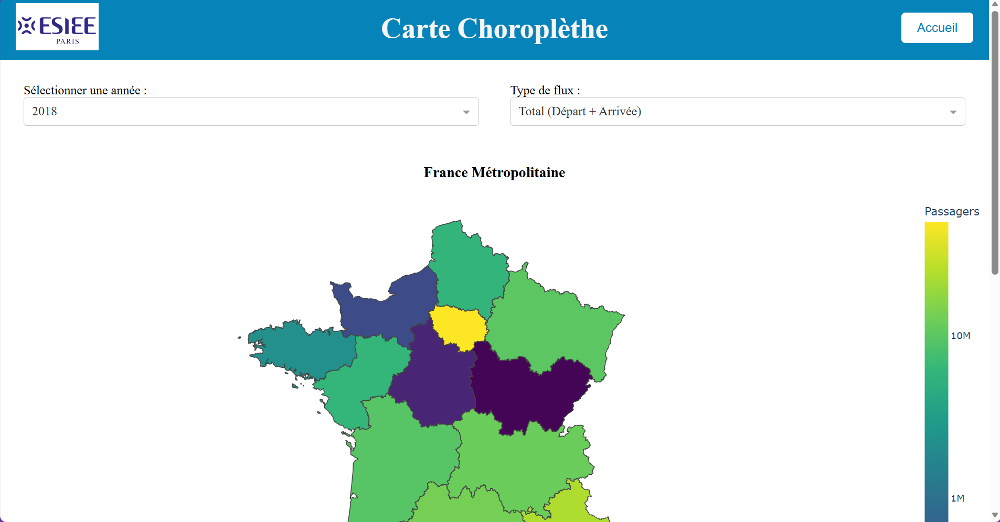
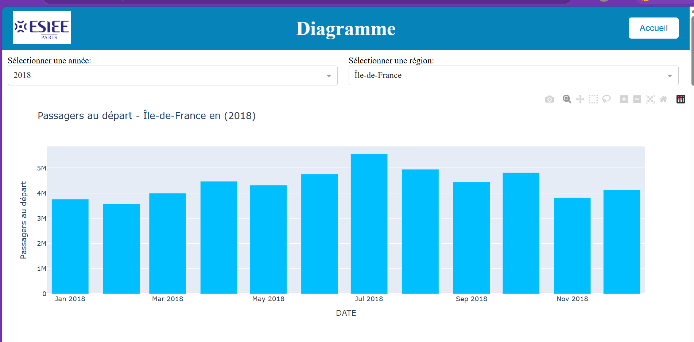
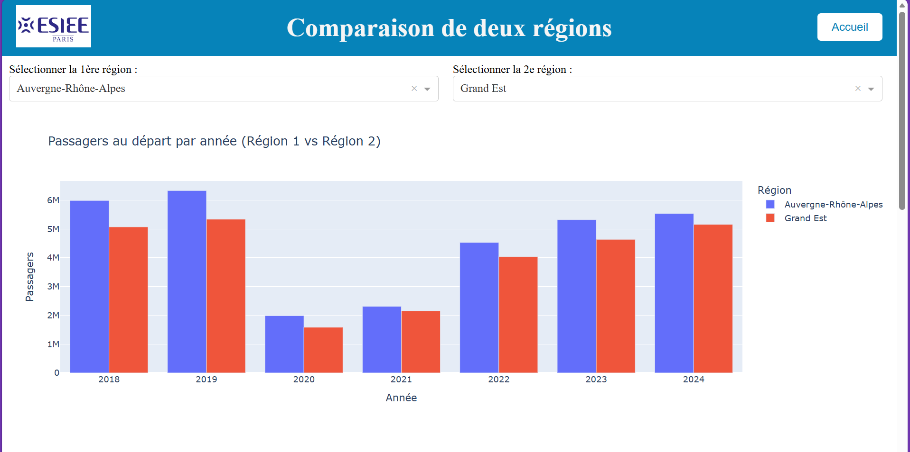

# ✈️ French Aviation Data — Analytics & Visualization

Application de **collecte, traitement et visualisation de données aéronautiques françaises**, développée en **Python** dans le cadre d'un projet multidisciplinaire à **ESIEE Paris**.

Le projet permet d'explorer et de comparer les données de l'aviation française entre **2018 et 2024**, à travers une interface web proposant des visualisations interactives, des diagrammes comparatifs et des représentations géographiques.

L'objectif est de transformer des données brutes en informations exploitables afin de faciliter leur analyse et leur interprétation.

<h2>📸 Aperçu de l'application</h2>

<div align="center">
  <h3>🗺️ Visualisation géographique</h3>
  

  <h3>📊 Analyse et comparaison des données</h3>
  <table>
    <tr>
      <td width="50%">
        
      </td>
      <td width="50%">
        
      </td>
    </tr>
  </table>
</div>

## ✨ Fonctionnalités

### 📊 Analyse et visualisation

- Exploration des données aéronautiques françaises de 2018 à 2024.
- Comparaison des données à travers différentes visualisations.
- Affichage de diagrammes pour faciliter l'analyse.
- Représentation géographique des données sur une carte.
- Interface web dédiée à la consultation des résultats.

### 🔄 Collecte et traitement des données

- Récupération de données depuis des sources externes.
- Scripts de collecte et de scraping.
- Nettoyage et préparation des données.
- Organisation des données brutes et nettoyées.
- Exploitation de fichiers CSV pour les visualisations.

### 🌐 Application web

- Interface interactive développée avec Python et Dash.
- Organisation des fonctionnalités en plusieurs modules.
- Intégration de ressources HTML et CSS.
- Séparation entre la collecte, le traitement et la visualisation des données.

## 🛠️ Technologies

| Technologie | Utilisation |
|---|---|
| Python | Développement et traitement des données |
| Dash | Création de tableaux de bord interactifs |
| HTML / CSS | Personnalisation de l'interface web |
| CSV | Stockage des données brutes et nettoyées |
| GeoJSON | Représentation des données géographiques |
| Git / GitHub | Versionnement et collaboration |

Les bibliothèques Python utilisées sont répertoriées dans `requirements.txt`.

## 🧠 Architecture du projet

Le projet repose sur une architecture modulaire permettant de séparer les différentes étapes du traitement des données.

```text
        Sources de données
                |
                v
       Collecte / Scraping
                |
                v
         Données brutes
          (data/raw)
                |
                v
      Nettoyage et traitement
                |
                v
        Données préparées
         (data/clean)
                |
                v
        Application Dash
                |
       +--------+--------+
       |        |        |
       v        v        v
 Comparaison  Cartes  Diagrammes
```

Cette organisation facilite la maintenance du projet et permet de distinguer les traitements de données des composants de visualisation.

## 🚀 Installation

### Prérequis

- Python
- pip
- Git (facultatif)

### 1. Cloner le repository

```bash
git clone URL_DU_REPOSITORY
```

Se placer dans le dossier du projet :

```bash
cd NOM_DU_REPOSITORY
```

### 2. Installer les dépendances

```bash
pip install -r requirements.txt
```

## ▶️ Utilisation

Pour démarrer l'application :

```bash
python main.py
```

Consulter les informations affichées dans le terminal pour accéder à l'interface web.

## 📂 Structure du projet

```text
.
├── app/
│   ├── dash_compare.py
│   ├── dash_diagramme.py
│   └── dash_map.py
│
├── common/
│   ├── api.py
│   ├── clean_data.py
│   ├── get_data.py
│   ├── regions.geojson
│   ├── scrapper.py
│   ├── server.py
│   └── use_data.py
│
├── data/
│   ├── clean/
│   │   └── 20**-data.csv
│   └── raw/
│       └── 20**-data.csv
│
├── static/
│   ├── css/
│   │   ├── diagramme.css
│   │   └── index.css
│   ├── images/
│   │   └── ESIEE_Paris_logo.png
│   └── templates/
│       └── index.html
│
├── data_info.png
├── region.json
├── main.py
├── requirements.txt
├── ruff.toml
└── README.md
```

## 🔍 Organisation des modules

### `app/` — Visualisation

Regroupe les composants de l'application :

- `dash_compare.py` : comparaison des données.
- `dash_diagramme.py` : affichage des diagrammes.
- `dash_map.py` : représentation cartographique.

### `common/` — Traitement des données

Contient les scripts nécessaires à la récupération, au nettoyage et à l'exploitation des données.

### `data/` — Stockage

Organise les données CSV en deux catégories :

- `raw/` : données brutes.
- `clean/` : données nettoyées et préparées.

### `static/` — Interface web

Contient les feuilles de style CSS, les images et les templates HTML utilisés par l'application.

## 👥 Équipe

Projet réalisé par :

- **Kadir Ersoy**
- **Lucas Pokrywa**
- **Valentin Hodonou**

## 🎓 Contexte académique

Projet multidisciplinaire de visualisation de données n°1, réalisé à **ESIEE Paris**.

Ce projet nous a permis de mettre en pratique plusieurs étapes du traitement des données : récupération, nettoyage, structuration, analyse et représentation graphique.

Il a également renforcé nos compétences en développement Python, en conception d'interfaces interactives et en travail collaboratif.
